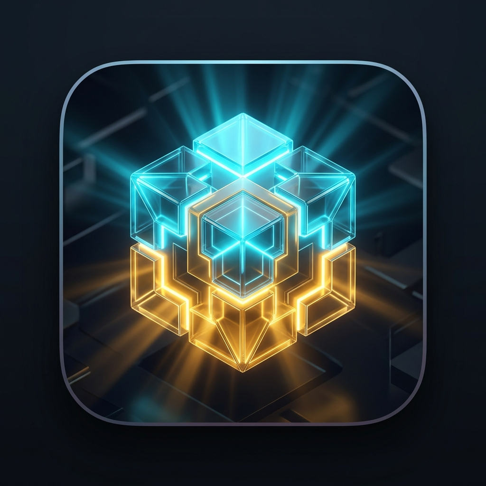
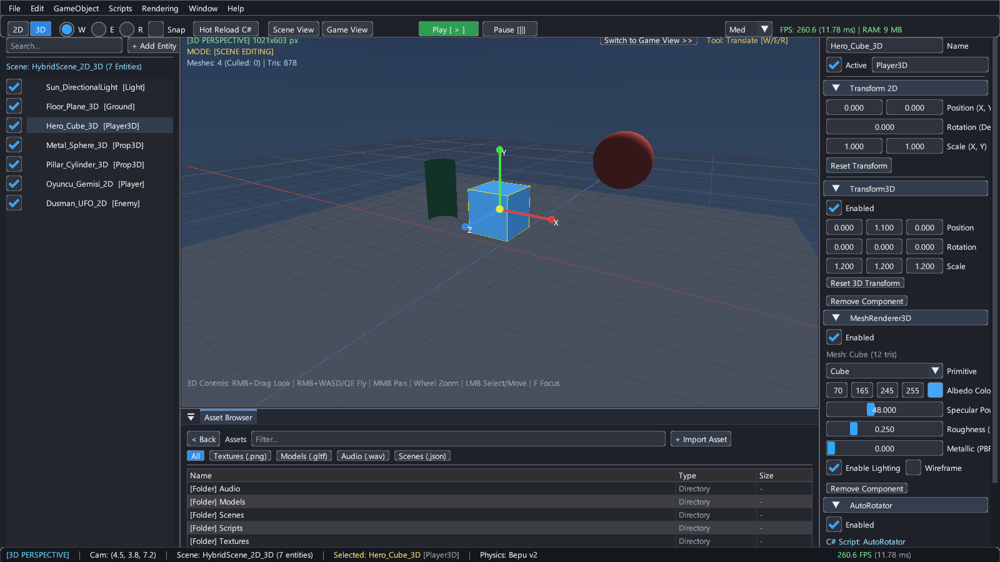
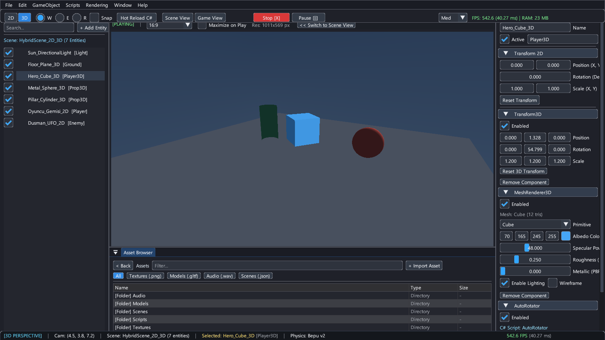

<p align="center">
  
</p>

<h1 align="center">Light Engine</h1>

<p align="center">
  <strong>A Modular, Low-Spec 2D + 3D Hybrid Game Engine & Interactive Editor in C# / .NET 9</strong><br>
  <em>Designed for smooth performance on integrated GPUs while delivering Half-Life 2 (2004) aesthetic fidelity.</em>
</p>

<p align="center">
  <a href="https://dotnet.microsoft.com/"></a>
  <a href="https://monogame.net/"></a>
  <a href="https://github.com/bepu/bepuphysics2"></a>
  <a href="https://github.com/ImGuiNET/ImGui.NET"></a>
  <a href="https://github.com/"></a>
  <a href="https://github.com/"></a>
  <a href="LICENSE"></a>
</p>

---

## Overview

**Light Engine** is an open-source, lightweight, cross-platform hybrid game engine built with modern **C# (.NET 9)** on top of **MonoGame (DesktopGL)**. It unites a high-performance 2D sprite engine with a 3D renderer inspired by classic early-2000s atmospheric titles (e.g. *Half-Life 2*), fully integrated with **BepuPhysics v2.4** SIMD physics, in-memory **Roslyn C# script compilation with Hot Reload**, and an intuitive **Docking Editor**.

Light Engine is built from the ground up to respect low-end machine constraints: it runs at stable 60+ FPS on 4 GB RAM and integrated Intel HD / Iris Xe graphics, consuming under 25 MB of memory.

---

## Editor Showcase

| Scene Viewport (Editing & Gizmos) | Game Viewport (Pure Runtime Playback) |
| :---: | :---: |
|  |  |
| *Full 3D/2D Gizmos (Translate/Rotate/Scale), Raycast Selection, Editor Grid & Fly Cam* | *Clean gameplay runtime view, Aspect Ratio presets (16:9, Free), Zero Gizmo clutter* |

---

## Key Systems & Engineering Features

### 1. Hybrid 2D & 3D Core Architecture
- **Decoupled Service Locator (`Engine.Services`)**: Subsystems communicate strictly via interfaces (`IRender3DService`, `IPhysics3DService`, `IInputService`, etc.), enabling high modularity and zero-dependency unit testing.
- **Fixed Timestep Simulation (60 Hz)**: Game loop decouples physics accumulation steps from variable rendering frame rates for deterministic collisions.
- **Zero-GC Memory Management**: Critical hot paths utilize pre-allocated `ObjectPool<T>` buffers, eliminating Gen0/Gen1 GC hitching.

### 2. 3D Atmospheric Rendering Pipeline
- **Material & Lighting**: Blinn-Phong and lightweight PBR specular highlights with metallic/roughness workflows.
- **Cascaded Shadow Maps (CSM)**: Multi-frustum shadow maps providing high-resolution shadows near the camera and broad coverage at a distance.
- **Static Radiosity Lightmaps**: Precomputed ambient occlusion and bounce lighting baked directly into UV coordinates.
- **Post-Processing Stack**: Toggable Bloom, FXAA anti-aliasing, Tone Mapping, and SSAO (Screen-Space Ambient Occlusion).
- **Procedural Systems**: Real-time analytical **Terrain3D** (Heightmap sampling), Rayleigh gradient Sky Dome, and camera-facing 3D Particle Emitters.

### 3. Physics & Dynamics
- **3D Physics (BepuPhysics v2.4)**: Ultra-fast unmanaged SIMD physics engine running dynamic rigid bodies, box/sphere/capsule colliders, and mesh terrains.
- **Character Controller 3D**: Upright momentum handling, ground snapping, slope traversal (up to 45°), and jump impulses.
- **2D Physics**: High-speed AABB / Circle collision detection with layers, triggers, and velocity integration.

### 4. Roslyn C# Scripting & Live Hot Reload
- **Collectible Assembly Loading**: Compiles `.cs` scripts in `Assets/Scripts/` directly in memory using `Microsoft.CodeAnalysis.CSharp`.
- **State Preservation**: Serializes public properties/fields during reload and restores them into newly compiled types on the fly.
- **Reflection Inspector**: Public variables automatically generate interactive ImGui controls (DragFloat, Checkbox, Text fields).

### 5. Dual-Viewport Docking Editor
- **Separated Scene & Game Modes**: Scene Viewport allows camera manipulation and gizmo dragging; Game Viewport runs pure runtime gameplay without editor interference.
- **One-Click Play / Stop Snapshot**: Hitting Play captures an in-memory JSON state of the scene; Stop cleanly restores every moved, knocked-over, or destroyed entity back to its exact edit-time state.
- **Native cimgui DockBuilder**: P/Invoke bindings automatically build a responsive 4-quadrant layout (Hierarchy, Center Viewports, Inspector, Asset Browser/Console).

---

## Project Structure

```text
BenimMotor/
├── LightEngine.Core/        # Core 2D+3D engine library
│   ├── Animation/           # 2D Sprite Animator & State Machine
│   ├── Animation3D/         # 3D Skeletal Animation & Cross-Fade Blending
│   ├── Assets/              # Cached Asset Manager (Textures, Models, Audio)
│   ├── Audio/               # 2D & 3D Spatial Audio Emitters
│   ├── Common/              # Engine.Services, ServiceLocator, ObjectPool, TimeManager
│   ├── Diagnostics/         # High-precision Stopwatch FPS / ms instrumentation
│   ├── Ecs/                 # Entity-Component-System & Scene hierarchies
│   ├── Input/               # Keyboard, Mouse, Gamepad action mapping
│   ├── Particles/           # Zero-GC Billboard Particle systems
│   ├── Physics2D/           # AABB / Circle colliders, layers, triggers
│   ├── Physics3D/           # BepuPhysics v2.4 integration & CharacterController3D
│   ├── Rendering/           # 2D SpriteBatch renderer & Camera2D
│   ├── Rendering3D/         # 3D Model Loader (glTF/OBJ), CSM, Lightmaps, PostProcess
│   ├── Scripting/           # In-memory Roslyn C# compiler & Hot Reload engine
│   └── Serialization/       # Human-readable JSON Scene Serializer
├── LightEngine.Editor/      # ImGui.NET visual editor & Standalone Exporter
├── Game/                    # Hybrid playable demo (F1: 2D demo | F2: 3D physics)
├── LightEngine.Tests/       # 9-stage automated verification test suite
├── docs/                    # Architecture, Physics, Rendering & Scripting manuals
└── dist/                    # Standalone self-contained executables (Win & Linux)
```

---

## Quick Start

### Prerequisites
- [.NET 9.0 SDK](https://dotnet.microsoft.com/download/dotnet/9.0) or higher.
- Any GPU with OpenGL 3.0+ support (including Intel HD Graphics 4000+).

### 1. Build and Run the Editor
```bash
# Clone the repository
git clone https://github.com/AhmetLight/LightEngine.git
cd LightEngine

# Build in Release mode
dotnet build LightEngine.slnx -c Release

# Launch the visual editor
dotnet run --project LightEngine.Editor/LightEngine.Editor.csproj
```

### 2. Run the Verification Test Suite
```bash
dotnet run --project LightEngine.Tests -c Release
```
*Executes all 9 engine verification stages (ServiceLocator, ECS, 2D Collision, JSON Round-Trip, Roslyn Hot Reload, BepuPhysics v2, Skeletal Blending, Spatial Audio, and Procedural Terrain).*

### 3. One-Click Standalone Packages (Zero .NET Installation Required)
You can package standalone single-file executables for Windows and Linux:
```bash
# Windows
build.bat publish

# Linux / macOS
chmod +x build.sh && ./build.sh publish
```
Compiled standalone binaries will be generated in `dist/windows/LightEngineEditor.exe` and `dist/linux/LightEngineEditor`.

---

## Editor Keyboard & Mouse Shortcuts

| Action | Shortcut |
| :--- | :--- |
| **Translate / Rotate / Scale Gizmo** | `W` / `E` / `R` |
| **3D Free Flight Camera** | `Right Click + WASD` (hold `Shift` to sprint, `Q`/`E` for vertical) |
| **Camera Pan** | `Middle Click` or `Space + Left Click Drag` |
| **Smooth Cursor Zoom** | `Mouse Wheel` |
| **Focus Camera on Selected Entity** | `F` |
| **Undo / Redo** | `Ctrl + Z` / `Ctrl + Y` |
| **Duplicate Entity / Delete** | `Ctrl + D` / `Delete` |
| **Save Active Scene (JSON)** | `Ctrl + S` |
| **Hot Reload All C# Scripts** | `F5` or Toolbar button |
| **Quick Switch between Scene & Game View** | Toolbar buttons `[Scene View]` / `[Game View]` |

---

## Writing Game Scripts

Create a `.cs` file in `Assets/Scripts/`:

```csharp
using LightEngine.Core.Scripting;
using Microsoft.Xna.Framework;
using Microsoft.Xna.Framework.Input;

namespace GameScripts;

public class TurretController : ScriptComponent
{
    // Public fields are automatically exposed in the Editor Inspector!
    public float TurnSpeed = 45.0f;
    public bool AutoTarget = true;

    public override void OnUpdate(float deltaTime)
    {
        if (Transform3D == null) return;

        if (Input.IsKeyDown(Keys.Left))
            Transform3D.Rotate(new Vector3(0, TurnSpeed * deltaTime, 0));

        if (Input.IsKeyDown(Keys.Right))
            Transform3D.Rotate(new Vector3(0, -TurnSpeed * deltaTime, 0));
    }
}
```
*Save your file, return to the editor, and watch the changes apply instantly without restarting the application!*

---

## Technical Documentation
- [System Architecture & Lifecycle (docs/ARCHITECTURE.md)](docs/ARCHITECTURE.md)
- [3D Physics & Character Controller (docs/PHYSICS_3D.md)](docs/PHYSICS_3D.md)
- [3D Rendering & Post-Processing (docs/RENDERING_3D.md)](docs/RENDERING_3D.md)
- [C# Scripting & Hot Reload Guide (docs/SCRIPTING.md)](docs/SCRIPTING.md)
- [Contribution Guidelines (CONTRIBUTING.md)](CONTRIBUTING.md)

---

## License

This project is licensed under the **MIT License** - see the [LICENSE](LICENSE) file for details.  
Created with dedication by **Ahmet Işık** & Light Engine Contributors.
