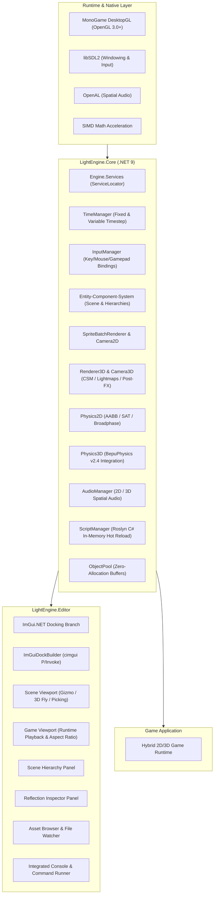
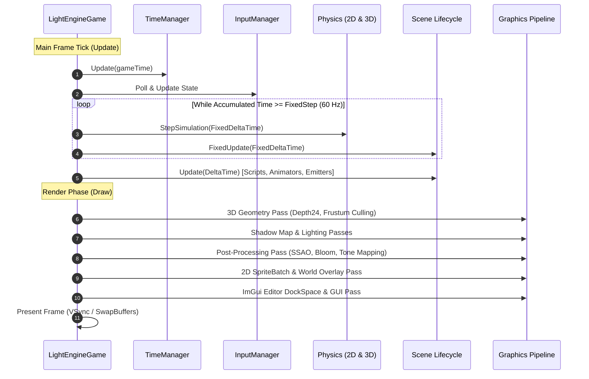

# Light Engine Architecture & Engineering Design

This document details the internal systems, lifecycle execution pipeline, memory management, and technical architecture of **Light Engine**.

---

## 1. High-Level System Architecture

Light Engine follows a clean decoupled architecture separated into core engine libraries, an interactive development editor, and runtime game projects:

---

## 2. Decoupled Service-Oriented Framework (`Engine.Services`)

All engine subsystems communicate through strictly typed interfaces managed by `ServiceLocator`. This eliminates hard static couplings and allows seamless mocking during test suites:

| Interface | Implementation | Primary Responsibility |
| :--- | :--- | :--- |
| `ITimeService` | `TimeManager` | Manages delta time, variable frame pacing, and fixed timestep accumulator (60 Hz). |
| `IInputService` | `InputManager` | Polls keyboard, mouse, gamepad, and evaluates configurable action maps. |
| `ISceneService` | `SceneManager` | Handles active scene transitions, lifecycle events, and serialization. |
| `IAssetService` | `AssetManager` | Resource caching for textures, meshes, sound effects, and shaders. |
| `IRenderService` | `RenderManager` | 2D batching pipeline with sorting and transformation matrices. |
| `IRender3DService` | `Renderer3D` | 3D rendering pipeline: Blinn-Phong, PBR-lite, Cascaded Shadow Maps, Soft Lightmap Baker, SSAO, Bloom, FXAA. |
| `IPhysics2DService` | `Physics2DManager` | 2D collision detection, broadphase sweep, layer masks, and trigger dispatch. |
| `IPhysics3DService` | `Physics3DManager` | BepuPhysics v2.4 simulation, raycasting, dynamic bodies, and character controller. |
| `IAudioService` | `AudioManager` | Spatial 3D sound listeners, distance attenuation, and BGM streaming. |
| `IScriptService` | `ScriptManager` | Roslyn C# syntax tree compilation with collectible AssemblyLoadContext hot reload. |

---

## 3. Game Loop & Frame Execution Pipeline

The game loop enforces deterministic physics updates while maintaining decoupled variable-rate rendering:

---

## 4. Memory Management & Zero-Allocation Principles

To guarantee stable 60+ FPS on low-spec integrated graphics (e.g. Intel HD Graphics + 4 GB RAM):
- **Object Pooling (`ObjectPool<T>`)**: Heavy or transient objects (collision contact manifolds, particle nodes, raycast hits) are recycled through thread-safe pools to eliminate garbage collection spikes (`GC Gen0`).
- **SIMD Optimized 3D Physics**: BepuPhysics v2 relies heavily on raw memory structures (`BufferPool`) and AVX2/NEON vector instructions, bypassing managed heap overhead.
- **Dynamic C# Hot Reload**: Uses `System.Runtime.Loader.AssemblyLoadContext(isCollectible: true)`. Scripts are compiled entirely in memory through Roslyn stream emitters; obsolete contexts are collected by GC without memory leakage or restarting the editor.
