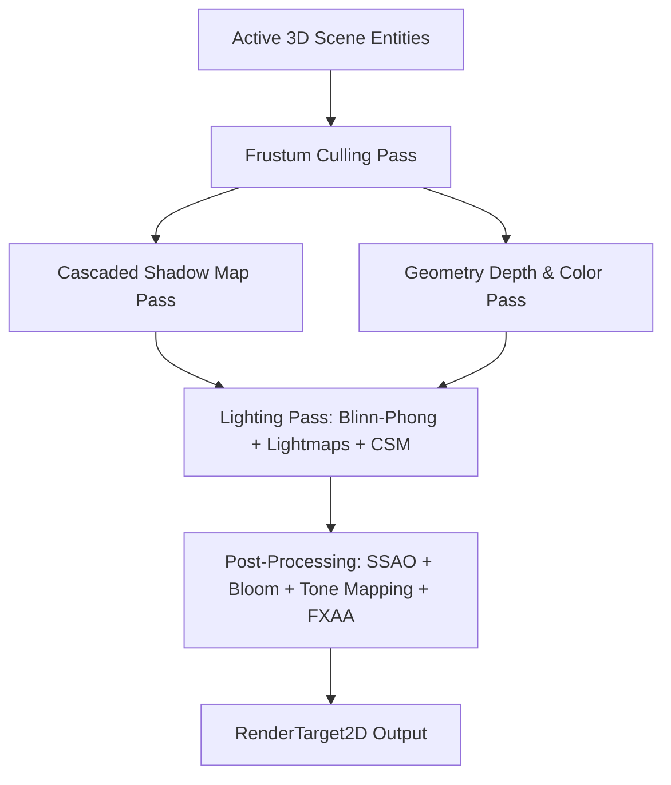

# 3D Rendering Pipeline & Atmospheric Graphics

Light Engine implements a custom 3D rendering pipeline engineered to deliver visual aesthetics reminiscent of **Half-Life 2 (2004)** and modern stylized indie games while maintaining a lightweight GPU footprint suitable for integrated graphics.

---

## 1. Graphics Pipeline Flow

---

## 2. Key Visual Systems

### A. Lighting & Shading
- **Blinn-Phong & Lightweight PBR**: Accurate specular highlights, diffuse falloff, and metallic/roughness material parameters.
- **Cascaded Shadow Mapping (CSM)**: Multi-frustum shadow maps that provide crisp self-shadowing close to the camera while maintaining broad coverage into the horizon.
- **Static Radiosity Lightmaps**: Precomputed ambient occlusion and bounce lighting baked into texture coordinates for ultra-cheap, photorealistic static lighting on low-end hardware.

### B. Procedural Atmosphere & Sky
- **Atmospheric Sky Dome**: Procedural gradient sky with dynamic Rayleigh scattering approximation.
- **Volumetric Fog**: Distance-based exponential height fog seamlessly blending terrain into the horizon.

### C. Procedural Terrain3D
- **Heightmap Sampling**: Real-time analytical terrain mesh generation supporting custom heightmap textures and algorithmic perlin noise.
- **Slope-based Splatting**: Automatic multi-texturing based on elevation and slope steepness (grass, rock, snow).

### D. Zero-GC 3D Particle System
- **Camera-Facing Billboards**: High-performance particle quads rendered using instanced vertex arrays.
- **Object Pool Buffer**: Particle lifetimes, velocity, color curves, and sizes update entirely on pre-allocated float buffers.
